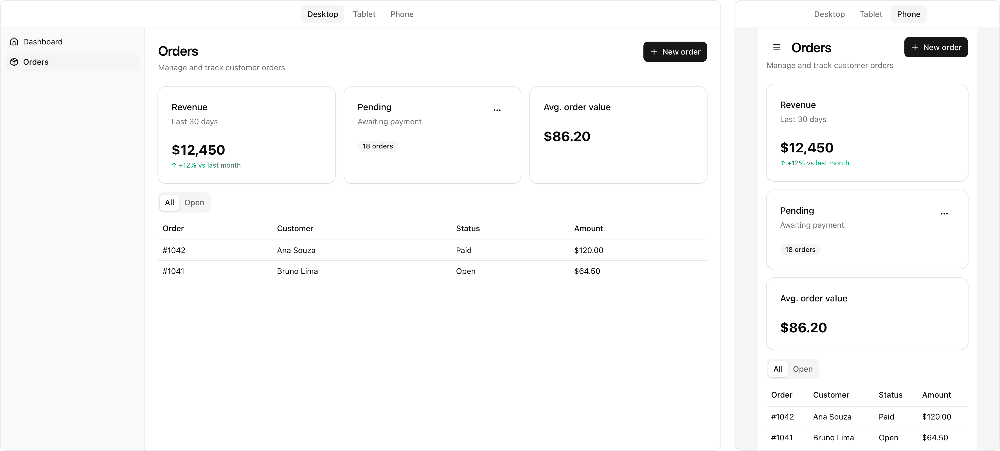
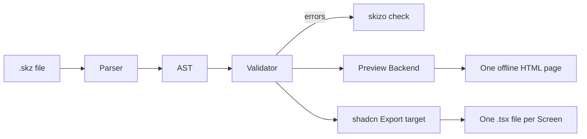

<p align="center">
  <picture>
    <source media="(prefers-color-scheme: dark)" srcset="docs/assets/logo/skizo-lockup-dark.svg">
    
  </picture>
</p>

<p align="center">A small language to sketch user interfaces, made for coding agents.</p>

<p align="center">
  <a href="https://jctosta.github.io/skizo/">Documentation</a> ·
  <a href="https://jctosta.github.io/skizo/#elements">Elements</a> ·
  <a href="https://jctosta.github.io/skizo/#examples">Examples</a> ·
  <a href="packages/cli/GUIDE.md">Agent guide</a>
</p>

Skizo (Esperanto for *sketch*) is an indentation-based language for UI sketches. An agent writes one Element on each line. The `skizo` command checks the file, shows it as a clickable Preview page and exports it as shadcn React code.

> Skizo is in alpha. The language and the CLI can change before version 1.0.

## Why Skizo

When you ask a coding agent for a UI mockup, it usually writes full React or HTML. That output is long and slow to change, and the agent adds components, state and styles that you did not ask for. Skizo gives the agent a small, fixed vocabulary instead:

- A sketch is short. The Orders example below is 36 lines of Skizo. Its shadcn export is 225 lines of TSX.
- There is one way to write each thing. Skizo has 31 Element types, and `skizo check` rejects all other types.
- `skizo check` shows all errors in one run, each with a hint. An agent can fix the file in one pass.
- The Preview is one HTML file that works offline. Links switch Screens, Buttons open Dialogs and Sheets, and Tabs, Menus and Selects work.
- The export is code that you keep. It imports the shadcn components of your own project.

## Example

```
Screen "Orders" id=orders subtitle="Manage and track customer orders"
  Sidebar
    Link "Dashboard" icon=home to=dashboard
    Link "Orders" icon=package to=orders
  actions
    Button "New order" icon=plus opens=new-order
  Grid cols=3
    Card "Revenue" desc="Last 30 days"
      Stat "$12,450" hint="+12% vs last month" trend=up
    Card "Pending" desc="Awaiting payment"
      actions
        Menu "Pending actions" icon=ellipsis icon-only variant=ghost
          Item "Send reminders"
          Item "Cancel all" destructive
      Badge "18 orders" variant=secondary
    Card "Avg. order value"
      Stat "$86.20"
  Tabs
    Tab "All" active
      Table cols="Order,Customer,Status,Amount"
        | #1042 | Ana Souza | Paid | $120.00
        | #1041 | Bruno Lima | Open | $64.50
    Tab "Open"
      Table cols="Order,Customer,Amount" rows=5
  Dialog "New order" id=new-order desc="Create an order for a customer."
    Input "Customer name" placeholder="Jane Doe"
    Select "Status" options="Open,Paid" value=Open
```

`skizo preview` turns it into this page:



The full file is [`examples/orders.skz`](examples/orders.skz). The [documentation](https://jctosta.github.io/skizo/#examples) shows it and four other sketches next to their live Preview and their shadcn export.

## Install

You need Node.js 22.12 or later and Git. Skizo installs from a Git tag. Always put the tag in the install command, so that each install gets the same release.

With pnpm (recommended):

```sh
pnpm add -g github:jctosta/skizo#v0.2.0-alpha.1
```

With npm:

```sh
npm install -g --allow-git=all github:jctosta/skizo#v0.2.0-alpha.1
```

The tag points to a commit on the `release` branch. That commit holds only the built CLI. It has no install scripts and no dependencies. To pin one exact build, use the commit hash of the tag instead of the tag. The [install section](https://jctosta.github.io/skizo/#getting-started) of the documentation shows how.

## Usage

The install gives two commands: `skizo` and its short alias `skz`.

```sh
skizo guide                                              # print the language reference for agents
skizo check orders.skz                                   # show all errors, each with a hint
skizo check orders.skz --json                            # the same errors as JSON
skizo preview orders.skz                                 # write orders.html, one offline page
skizo preview orders.skz --watch                         # serve the page and reload it on each save
skizo export orders.skz --target shadcn --out src/screens   # write one .tsx file for each Screen
skizo export orders.skz --target shadcn --router next       # write the links with Link from next/link
```

`preview` and `export` do not accept a file that fails `check`. The exit code is 0 for success, 1 when the file has errors, and 2 when the command is not correct or Skizo cannot read the file.

## Use Skizo with an agent

`skizo guide` prints the full language in about 1,200 tokens. Add these lines to the instructions for your agent, for example in `AGENTS.md` or `CLAUDE.md`:

```
Before you write UI code, make a sketch in Skizo:
1. Run `skizo guide` and read the Guide.
2. Write the sketch in <name>.skz.
3. Run `skizo check <name>.skz`. Fix all errors. Do this step again until the command shows no errors.
4. Run `skizo preview <name>.skz` and give me the HTML file.
```

While the agent works, keep `skizo preview <name>.skz --watch` open. The page reloads after each save that passes `check`.

## Elements

| Group | Element types |
|---|---|
| Screens and navigation | [Screen](https://jctosta.github.io/skizo/#screen), [Sidebar, Link](https://jctosta.github.io/skizo/#sidebar) |
| Layout | [Stack, Row](https://jctosta.github.io/skizo/#stack), [Grid](https://jctosta.github.io/skizo/#grid), [Separator](https://jctosta.github.io/skizo/#separator), [Card](https://jctosta.github.io/skizo/#card), [Tabs, Tab](https://jctosta.github.io/skizo/#tabs) |
| Content | [Heading](https://jctosta.github.io/skizo/#heading), [Text](https://jctosta.github.io/skizo/#text), [Stat](https://jctosta.github.io/skizo/#stat), [Badge](https://jctosta.github.io/skizo/#badge), [Avatar](https://jctosta.github.io/skizo/#avatar), [Image](https://jctosta.github.io/skizo/#image), [Alert](https://jctosta.github.io/skizo/#alert), [Progress](https://jctosta.github.io/skizo/#progress), [Table](https://jctosta.github.io/skizo/#table), [List](https://jctosta.github.io/skizo/#list) |
| Actions and forms | [Button](https://jctosta.github.io/skizo/#button), [Input](https://jctosta.github.io/skizo/#input), [Textarea](https://jctosta.github.io/skizo/#textarea), [Select](https://jctosta.github.io/skizo/#select), [Checkbox, Switch](https://jctosta.github.io/skizo/#checkbox), [Radio](https://jctosta.github.io/skizo/#radio) |
| Overlays | [Dialog](https://jctosta.github.io/skizo/#dialog), [Sheet](https://jctosta.github.io/skizo/#sheet), [Menu, Item](https://jctosta.github.io/skizo/#menu) |

The [Element reference](https://jctosta.github.io/skizo/#elements) shows the props, the rules and a live Preview for each type.

## How it works



The repository has two packages:

- `packages/core` holds the parser, the AST and the validator. It uses no Node.js APIs, so a browser can run it too. It is private and not published.
- `packages/cli` is `@jctosta/skizo`. It holds the commands, the two Backends and the Guide, and it bundles `core`.

The AST is the contract between the two. The Backends never read the source text, and the validator knows nothing about the Backends.

## Development

You need Node.js 22.18 or later and pnpm 12. The slow tests also need the Chromium build of Playwright.

```sh
pnpm install
pnpm exec playwright install chromium   # once, for the slow tests
pnpm test          # fast tests, in process (about 1 second)
pnpm test:slow     # browser, type-check and package tests
pnpm test:all      # all tests
pnpm typecheck
pnpm build         # build packages/cli/dist
pnpm build:docs    # build docs/index.html from docs/content.mjs, the schemas and examples/
```

The tests call the CLI in process and compare its output with golden files in `packages/cli/test/fixtures/`. [`packages/cli/GUIDE.md`](packages/cli/GUIDE.md) is the language reference that `skizo guide` prints. [`GLOSSARY.md`](GLOSSARY.md) defines the terms.

To make a release:

1. Change `version` in `packages/cli/package.json` and commit.
2. Run `pnpm release`. The command runs all tests, commits the built CLI to the `release` branch, tags it, and installs the tag from Git to make sure that it works.
3. Push the branch and the tag with the command that `pnpm release` prints.

## License

[MIT](LICENSE). The icons come from [Lucide](https://lucide.dev) (ISC license). The package includes the Lucide license as `assets/LICENSE-lucide.txt`.
